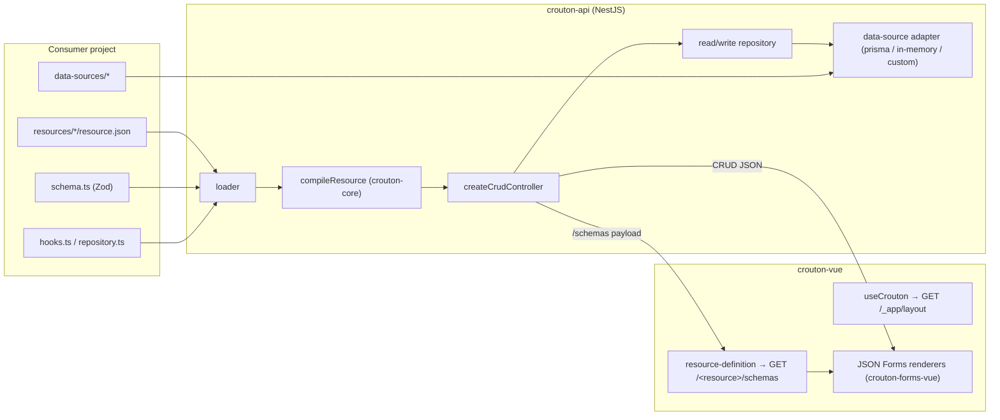
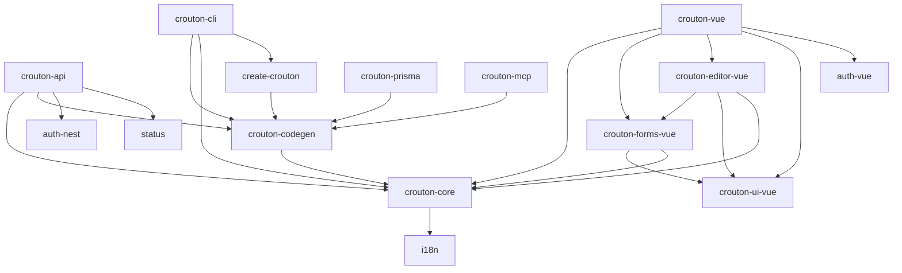

# Architecture

How crouton is put together internally. Read this before changing crouton itself; for *using* crouton, start at
[Getting started](../1.getting-started/index.md).

## Big picture

One `resource.json` per resource is the single source of truth. The backend compiles it into REST routes **and** a
UI payload (JSON Schema + JSON Forms UI schema); the frontend renders tables and forms from that payload at runtime.
No per-resource frontend code is generated.



## Packages

| Package | Runtime | Role |
|---|---|---|
| `crouton-core` | browser + node | Zod schemas for `resource.json`, the pure compile step, layout/view/table builders, request + filter models. **No Node-only imports.** |
| `crouton-api` | node | NestJS module: loads resources from disk, builds one controller per resource, data access, security, hooks, `/schemas` endpoints. |
| `crouton-vue` | browser | Admin shell (router, sidebar, `useCrouton`), resource views, re-exports the three `*-vue` packages below. |
| `crouton-forms-vue` | browser | JSON Forms renderers + testers (one renderer per field-input type). |
| `crouton-ui-vue` | browser | Plain UI components (buttons, modals, tables). No crouton knowledge. |
| `crouton-editor-vue` | browser | Visual resource editor (dev mode). |
| `crouton-codegen` | node, private | Shared Node-only tooling: `crouton.json` loading, Prisma introspection/shell, scaffolding, migrations, plan/diff/apply. |
| `crouton-cli` | node | `crouton` CLI. Thin commands on top of `crouton-codegen`. |
| `crouton-prisma` | node | Prisma generator → Zod schemas. |
| `crouton-mcp` | node | MCP server for LLM agents, on top of `crouton-codegen`. |
| `create-crouton` / `add-crouton` | node | Project scaffolders (templates in `create-crouton/templates`). |
| `crouton-auth` | node | Public auth-provider API, wraps `libs/auth`. |
| `libs/*` (`@crouton/*`) | mixed | Internal, bundled into the packages above: `auth`, `auth-nest`, `auth-vue`, `i18n`, `status`. |

### Dependency graph



Regenerate with `pnpm nx graph`. Rules:

- `crouton-core` must stay browser-safe — it is imported by `crouton-vue`.
- Node-only logic shared by CLI, API, MCP and scaffolders goes in `crouton-codegen`, never in one of its consumers.
- Frontend packages never import `crouton-api`; the HTTP payload contracts live in `crouton-core/src/lib/schema/response`.

## Backend lifecycle

### 1. Boot — load

`CroutonApiModule` (`packages/crouton-api/src/lib/crouton-api.module.ts`):

1. Reads `crouton.json` (`crud/config`), the enum registry and auth providers.
2. Loads data sources (`crud/data-access/adapter/data-source.loader.ts`) into a `DataSourceRegistry`.
3. Loads resources (`crud/loader/index.ts` → `loadResourceConfigsFromDir`): for each folder it imports
   `schema.ts`, `hooks.ts`, `repository.ts`, migrates `resource.json` to the current version, discovers
   sub-resources, then compiles.
4. Validates each resource against its adapter. A broken resource is **skipped and recorded** in
   `resourceLoadErrorsRegistry` (visible on the status page) instead of crashing the server.

### 2. Compile — pure

`compileResource(json, zodSchema, { enums, resolvers })` in `packages/crouton-core/src/lib/compile/compile-resource.ts`
turns `ResourceJson` into a `CompiledResource`: relation types, enum values, field variants, calculated columns,
layout visibility, search/lookup config, sub-resources and the form/table/view layouts (`layout/builders`).

Core never touches the filesystem: anything that needs another resource or a file is injected through
`CompileResolvers` by the API loader.

### 3. Serve — controllers

`createCrudController` (`crud/crud-controller.factory.ts`) builds one NestJS controller class per resource.
`operations/register-endpoints.ts` attaches routes in a fixed order — **static routes before `:id` routes**:

1. Sub-resource routes (`/<child>/schemas`, CRUD)
2. `findAll`, dev-only `resource.json` endpoints, `/definition`
3. `/unique`
4. `/schemas`, `findOne`, `create`, `update`, `patch`, `delete`
5. Row and table action routes

Each operation lives in its own `operations/register-<op>.ts`. Request bodies are validated with the resource's Zod
schema (`zod-validation.pipe.ts`); access is checked by `CroutonSecurityGuard`.

App-wide endpoints: `GET /_app/layout` (sidebar, defaults, `isDev`), status, auth.

### 4. Data access

```
controller → read.repository / write.repository → hooks (before) → adapter → middleware → hooks (after)
```

| Folder (`crud/data-access/`) | What |
|---|---|
| `adapter/` | `prisma`, `in-memory` and custom adapters behind `DataSourceAdapter` |
| `query/` | filter, sort, select, search → adapter query |
| `middleware/` | relation loading, value-label decoration, lifecycle hooks |

Resources with `kind: "custom"` route through the user's `repository.ts` (`crud/custom-repository`).

### Dev mode

`CROUTON_SCHEMA_EDITOR` enables `IS_DEV` (`crud/dev-mode.ts`): `ResourceConfigRegistry` re-reads `resource.json` on
each `/schemas` request, and editor endpoints (`crud/dev/`, raw `resource.json` GET/PUT/PATCH) are registered.

## Frontend lifecycle

1. `CroutonRouter` (`packages/crouton-vue/src/router.ts`) mounts `AdminView` and `crouton/:formId`.
2. `useCrouton` fetches `GET /_app/layout` → sidebar + global settings.
3. `ResourceView` asks `resource-definition.ts` for `GET /<resource>/schemas` (cached per URI).
4. The payload holds `table`, `form` and `view` schemas (JSON Schema + UI schema). JSON Forms renders them with the
   renderers registered in `crouton-forms-vue` (tester → renderer, keyed on `options.format`).
5. CRUD calls go through `useApi` / `resource.api.ts` to the URIs embedded in the payload.

Because the frontend only interprets the payload, most features are a backend/core change plus, at most, one
renderer.

## Tooling flow

```
crouton CLI / MCP / create-crouton
        └─ crouton-codegen: loadConfig → introspect (Prisma) → plan → diff → apply/write
```

`crouton update resources` introspects the database/Prisma schema and writes or updates `resource.json` files;
`crouton validate` runs the same Zod schemas the API uses at boot.

## Generated artefacts

| Source | Command | Output |
|---|---|---|
| Zod schemas in `crouton-core/src/lib/resource` | `pnpm nx run crouton-core:build` | `resource.schema*.json`, `docs/.vuepress/public/schema/*.json`, `docs/guide/2.resources/field-inputs/_generated/` |
| `docs/guide/**` | `crouton-core:build-agent-docs` | `packages/crouton-core/agent-docs/` (shipped to consumers' agents) |
| Template deps | `tools/template-dep-versions.mjs` | resolved `{{dep:*}}` tokens in scaffolds |

Never edit generated files by hand; change the source and rebuild.

## Where to change what

| I want to… | Start in |
|---|---|
| Add a `resource.json` option | `crouton-core/src/lib/resource/*.schema.ts` |
| Change compiled output | `crouton-core/src/lib/compile/` |
| Change form/table/view layout | `crouton-core/src/lib/layout/` |
| Add/change an HTTP route | `crouton-api/src/lib/crud/operations/register-*.ts` |
| Change querying | `crouton-api/src/lib/crud/data-access/query/` |
| Add a field input | `crouton-core/.../field-input/types/` + `crouton-forms-vue/.../renderers/controls/` |
| Change admin shell | `crouton-vue/src/admin`, `router.ts`, `composables/` |
| Add a CLI command | `crouton-cli/src/commands/` (logic in `crouton-codegen`) |
| Change scaffolds | `create-crouton/templates/` |
